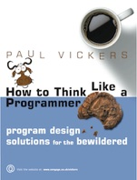

My name is Paul Vickers and I am Professor Emeritus of Computer Science & 
Sonification at Northumbria University in Newcastle-upon-Tyne, UK.

I worked in the School of [Computer Science](https://www.northumbria.ac.uk/about-us/our-schools/school-of-computer-science/) at [Northumbria University](https://www.northumbria.ac.uk/) from 2001 to 2026. Following my retirement I moved to a Professor Emeritus role. I also have an 
[official university web page](https://www.northumbria.ac.uk/about-us/our-staff/v/paul-vickers/).

{: .align-right}
I am the author of [How To Think Like A Programmer](http://www.howtothinklikeaprogrammer.com).
 

Prior to October 2001 I worked for 12 years in the School of Computing & Mathematical Sciences at Liverpool John Moores University.

I  served as a board member of the [International Community for Auditory Display](http://www.icad.org) 2004-2012, 2015-2018, 2019–2022, and as President from 2022–2026.